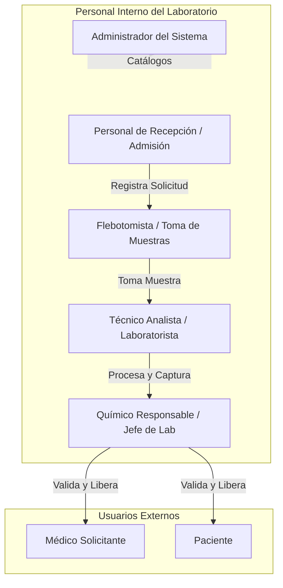

# Especificación de Usuarios, Roles y Matriz de Permisos
## Sistema de Gestión de Laboratorio de Análisis Clínicos

---

### 1. Introducción y Modelo de Seguridad (RBAC)

El presente documento define la arquitectura de control de acceso basada en roles (**Role-Based Access Control - RBAC**) y el principio de **mínimo privilegio** y **segregación de funciones** para el Sistema de Gestión del Laboratorio de Análisis Clínicos.

El sistema garantiza la integridad de los datos médicos, la trazabilidad estricta de las muestras y la confidencialidad de la información clínica conforme a las normativas sanitarias y de protección de datos personales en salud.

---

### 2. Catálogo de Usuarios y Roles del Sistema

Se identifican siete (7) roles de usuario con responsabilidades y fronteras operativas claramente delimitadas:

---

### 3. Detalle de Roles: Actividades Permitidas y No Permitidas

#### Rol 1: Administrador del Sistema (`ROLE_ADMIN`)
* **Descripción del Perfil**: Personal de TI o gestión técnica responsable de la disponibilidad, seguridad, catálogos base y configuración global del sistema de base de datos.
* **Actividades Permitidas**:
  1. Crear, suspender y gestionar cuentas de usuario de todo el personal interno.
  2. Asignar y revocar roles y permisos a usuarios del sistema.
  3. Gestionar catálogos base del sistema (sucursales, metodologías, tipos de contenedor/tubos).
  4. Monitorear el rendimiento de la base de datos, ejecución de índices y planes de particionamiento.
  5. Ejecutar y programar respaldos y políticas de retención histórica de datos.
  6. Consultar bitácoras de auditoría de accesos e intentos fallidos de autenticación.
* **Actividades NO Permitidas (Restricciones)**:
  1. **NO permitido** capturar, editar o validar resultados de estudios clínicos.
  2. **NO permitido** registrar tomas de muestras ni asignarse a procesamientos analíticos.
  3. **NO permitido** eliminar registros de auditoría o históricos de resultados (`DELETE` restringido).
  4. **NO permitido** alterar órdenes médicas o prescripciones de estudios.

---

#### Rol 2: Personal de Recepción / Admisión (`ROLE_RECEPCION`)
* **Descripción del Perfil**: Personal administrativo de primera línea que atiende a los pacientes al llegar al laboratorio, registra sus solicitudes y entrega resultados liberados.
* **Actividades Permitidas**:
  1. Registrar pacientes nuevos y actualizar datos demográficos y antecedentes operativos (alergias, ayuno, contacto).
  2. Registrar y actualizar información de médicos solicitantes en el catálogo.
  3. Crear nuevas órdenes/solicitudes de estudios clínicos asociadas a un paciente y médico solicitante.
  4. Consultar el estado general del flujo de solicitudes (`REGISTRADA`, `MUESTRAS_TOMADAS`, `EN_PROCESAMIENTO`, `CONCLUIDA`, `ENTREGADA`).
  5. Imprimir y entregar comprobantes de solicitud y órdenes de toma de muestra con identificadores/código de barras.
  6. Consultar, imprimir y enviar por correo los informes de resultados únicamente si se encuentran en estado `VALIDADO / LIBERADO`.
  7. Registrar cancelaciones de solicitudes que aún se encuentren en estado `REGISTRADA` (antes de la toma de muestra), con justificación obligatoria.
* **Actividades NO Permitidas (Restricciones)**:
  1. **NO permitido** capturar valores de resultados de análisis clínicos.
  2. **NO permitido** visualizar o consultar resultados preliminares en estado `PENDIENTE_VALIDACION`.
  3. **NO permitido** validar o liberar técnicamente resultados clínicos.
  4. **NO permitido** modificar los valores de referencia o metodologías del catálogo de estudios.
  5. **NO permitido** marcar muestras como tomadas o procesadas.
  6. **NO permitido** modificar el estado operativo de los equipos de laboratorio.
  7. **NO permitido** eliminar pacientes o solicitudes que ya cuenten con muestras tomadas o estudios en proceso.

---

#### Rol 3: Flebotomista / Personal de Toma de Muestras (`ROLE_FLEBOTOMIA`)
* **Descripción del Perfil**: Personal técnico especializado en la recolección, rotulado y acondicionamiento inicial de las muestras biológicas del paciente.
* **Actividades Permitidas**:
  1. Consultar la lista de pacientes y estudios pendientes de toma de muestra en tiempo real.
  2. Consultar las condiciones preanalíticas requeridas por cada estudio (ayuno, tipo de tubo, volumen requerido, aditivo anticoagulante).
  3. Registrar la toma efectiva de muestras con fecha, hora exacta, técnico responsable y condiciones del paciente.
  4. Generar e imprimir etiquetas con código de barras unívoco para cada tubo/recipiente de muestra.
  5. Registrar incidencias preanalíticas y rechazos de muestra (muestra insuficiente, hemólisis, lipemia, rechazo por falta de ayuno).
  6. Registrar la entrega y transferencia física de las muestras al área de procesamiento analítico.
  7. Registrar tomas adicionales en caso de requerirse una nueva muestra por repetición de estudio autorizada.
* **Actividades NO Permitidas (Restricciones)**:
  1. **NO permitido** capturar valores de mediciones o resultados de laboratorio.
  2. **NO permitido** validar o liberar resultados de estudios.
  3. **NO permitido** modificar la orden de estudios (no puede agregar o quitar estudios solicitados).
  4. **NO permitido** registrar datos de procesamiento analítico en equipos.
  5. **NO permitido** modificar el estado de disponibilidad o calibración de los equipos analíticos.
  6. **NO permitido** alterar datos personales o antecedentes clínicos del paciente.

---

#### Rol 4: Técnico Analista / Laboratorista (`ROLE_ANALISTA`)
* **Descripción del Perfil**: Personal de laboratorio que opera los analizadores clínicos, prepara reactivos, procesa muestras y captura mediciones analíticas.
* **Actividades Permitidas**:
  1. Consultar la lista de muestras recibidas pendientes de análisis y estudios pendientes de procesamiento.
  2. Asignar muestras y estudios a equipos analíticos compatibles que se encuentren en estado `ACTIVO / OPERATIVO`.
  3. Registrar los datos del procesamiento analítico: equipo utilizado, muestra analizada, reactivo/lote, fecha/hora inicio y fin.
  4. Capturar los valores brutos de resultados obtenidos (numéricos o cualitativos).
  5. Visualizar alertas automáticas del sistema cuando un valor capturado esté fuera de los rangos de referencia (valores de pánico o críticos).
  6. Solicitar la repetición de un estudio cuando el resultado analítico presente inconsistencias, registrando el motivo técnico.
  7. Reportar incidencias o fallas en equipos para solicitar su pase a `FUERA_DE_SERVICIO`.
* **Actividades NO Permitidas (Restricciones)**:
  1. **NO permitido** validar o autorizar la liberación final de resultados para entrega al paciente o médico (requiere aprobación del Químico Responsable).
  2. **NO permitido** sobreescribir o eliminar resultados capturados previamente (todo reanálisis debe registrarse como nueva versión auditada).
  3. **NO permitido** procesar muestras en equipos con estado `FUERA_DE_SERVICIO` o `EN_MANTENIMIENTO`.
  4. **NO permitido** modificar rangos de valores de referencia o metodologías analíticas del catálogo.
  5. **NO permitido** eliminar solicitudes, muestras o registros de pacientes.

---

#### Rol 5: Químico Responsable / Responsable Sanitario (`ROLE_RESPONSABLE`)
* **Descripción del Perfil**: Profesional facultado legalmente (cédula profesional sanitaria) para auditar, supervisar el control de calidad analítico, validar y liberar dictámenes de laboratorio.
* **Actividades Permitidas**:
  1. Consultar y auditar la totalidad de resultados capturados en estado `PENDIENTE_VALIDACION`.
  2. Validar, firmar electrónicamente y liberar resultados para su publicación y entrega oficial.
  3. Rechazar resultados capturados por inconsistencias analíticas y ordenar obligatoriamente la repetición del estudio (indicando si se reanaliza la muestra actual o se requiere nueva toma).
  4. Modificar resultados preliminares antes de su liberación, con justificación mandatoria registrada en la bitácora de auditoría.
  5. Gestionar el catálogo oficial de estudios: dar de alta pruebas, editar metodologías y configurar rangos de referencia por edad y sexo.
  6. Cambiar el estado operativo de los equipos analíticos (`ACTIVO`, `FUERA_DE_SERVICIO`, `EN_MANTENIMIENTO`, `EN_CALIBRACION`).
  7. Consultar la bitácora integral de auditoría de modificaciones, repeticiones y productividad por equipo/personal.
  8. Consultar historiales clínicos completos de cualquier paciente atendido en el laboratorio.
* **Actividades NO Permitidas (Restricciones)**:
  1. **NO permitido** realizar borrado físico (`DELETE`) de registros históricos, muestras, solicitudes o versiones de resultados.
  2. **NO permitido** desactivar o eludir los triggers y mecanismos de auditoría del sistema.
  3. **NO permitido** alterar los registros de usuarios o privilegios de base de datos (función exclusiva de TI/Admin).

---

#### Rol 6: Médico Solicitante (`ROLE_MEDICO_EXTERNO`)
* **Descripción del Perfil**: Profesional de la salud externo que prescribe estudios clínicos a sus pacientes y requiere consultar los reportes emitidos.
* **Actividades Permitidas**:
  1. Consultar la lista y estatus de las solicitudes emitidas bajo su cédula o nombre.
  2. Consultar y descargar los informes de resultados oficiales de sus pacientes que estén en estado `VALIDADO / LIBERADO`.
  3. Consultar el historial comparativo de resultados acumulados de los pacientes a los que ha atendido en el laboratorio.
  4. Registrar pre-solicitudes electrónicas de estudios para sus pacientes (si el portal médico está disponible).
* **Actividades NO Permitidas (Restricciones)**:
  1. **NO permitido** consultar solicitudes o resultados de pacientes asignados a otros médicos (estricta confidencialidad médica).
  2. **NO permitido** consultar resultados preliminares que no hayan sido formalmente validados por el Químico Responsable.
  3. **NO permitido** capturar, editar o validar resultados de estudios.
  4. **NO permitido** modificar estados operativos de equipos o muestras.
  5. **NO permitido** acceder a la configuración interna del laboratorio o costos/finanzas.

---

#### Rol 7: Paciente (`ROLE_PACIENTE`)
* **Descripción del Perfil**: Usuario final titular de las muestras y estudios clínicos realizados en el laboratorio.
* **Actividades Permitidas**:
  1. Consultar el estatus de sus solicitudes activas mediante folio y credenciales seguras de acceso.
  2. Consultar y descargar sus reportes de resultados oficiales concluidos (`VALIDADO / LIBERADO`).
  3. Consultar su historial histórico consolidado de estudios realizados en la institución.
  4. Consultar las indicaciones de preparación previa para estudios programados (horas de ayuno, dietas especiales, recolección).
* **Actividades NO Permitidas (Restricciones)**:
  1. **NO permitido** consultar información de ningún otro paciente registrado en el sistema.
  2. **NO permitido** consultar resultados de estudios que se encuentren en estado preliminar, en proceso o en repetición.
  3. **NO permitido** modificar ningún dato clínico, solicitud, muestra o resultado.
  4. **NO permitido** visualizar notas internas técnicas de analistas o bitácoras de equipos.

---

### 4. Matriz de Control de Acceso y Operaciones (CRUD)

La siguiente matriz resume los permisos sobre cada entidad/módulo del sistema:
- **C**: Crear (Create / Insert)
- **R**: Leer / Consultar (Read / Select)
- **U**: Modificar (Update)
- **D**: Eliminar (Delete / Soft Delete)
- **V**: Validar / Liberar (Validate / Sign)
- **-**: Sin acceso / Operación Prohibida

| Módulo / Entidad | Administrador | Recepción | Flebotomista | Técnico Analista | Químico Responsable | Médico Externo | Paciente |
| :--- | :---: | :---: | :---: | :---: | :---: | :---: | :---: |
| **Usuarios y Roles** | C R U D | - | - | - | - | - | - |
| **Pacientes (Datos y Antecedentes)** | R U | C R U | R | R | R | R (Propios) | R (Propios) |
| **Médicos (Directorio)** | C R U D | C R U | R | R | R | R (Propio) | - |
| **Catálogo de Estudios y Ref.** | R | R | R | R | C R U | R | R (Público) |
| **Solicitudes / Órdenes** | R | C R U* | R | R | R U | C R (Propias) | R (Propias) |
| **Muestras (Toma y Etiquetado)** | R | - | C R U | R | R | - | - |
| **Equipos (Catálogo y Estado)** | C R U D | - | - | R (Reportar) | C R U (Estado) | - | - |
| **Procesamiento de Muestras** | R | - | - | C R U | R | - | - |
| **Resultados (Captura / Mediciones)**| R | - | - | C R (Borrador)| C R U V | - | - |
| **Resultados (Liberados / Oficiales)**| R | R (Imprimir) | - | R | R V | R (Asignados) | R (Propios) |
| **Repeticiones / Inconsistencias** | R | - | - | C (Solicitar) | C R U V (Aprobar)| - | - |
| **Bitácora de Auditoría** | R | - | - | - | R | - | - |

*\*Nota: Recepción solo puede modificar solicitudes antes de que se recolecten las muestras.*

---

### 5. Reglas de Segregación de Funciones (Separation of Duties - SoD)

Para asegurar la validez analítica y el cumplimiento legal, el sistema implementa a nivel de base de datos las siguientes reglas duras:

1. **SoD-01 (Toma vs. Análisis)**: Un usuario con rol exclusivo de flebotomista no puede registrar corridas en equipos ni capturar valores en la tabla `Resultados`.
2. **SoD-02 (Captura vs. Validación)**: Un resultado en estado `PRELIMINAR` capturado por un Técnico Analista no puede ser publicado al paciente ni al médico hasta contar con la firma/aprobación de un usuario con rol de `Químico Responsable`.
3. **SoD-03 (Inmutabilidad de Resultados)**: Ningún usuario (incluyendo administradores y químicos) puede ejecutar un `DELETE` sobre registros en las tablas `Resultados` o `Historico_Modificaciones_Resultados`. Las correcciones se realizan como nuevas versiones con referencia al registro anterior y justificación obligatoria.
4. **SoD-04 (Restricción de Equipos Fuera de Servicio)**: El sistema debe rechazar a nivel transaccional la inserción de un registro en `Procesamiento` si el equipo asociado tiene estatus distinto de `ACTIVO / OPERATIVO`.
5. **SoD-05 (Aislamiento de Privacidad Multi-tenant por Médico y Paciente)**:
   - Toda consulta realizada por un paciente debe filtrar forzosamente por su `id_paciente` validado en sesión.
   - Toda consulta realizada por un médico debe filtrar exclusivamente por su `id_medico` en las solicitudes correspondientes.
