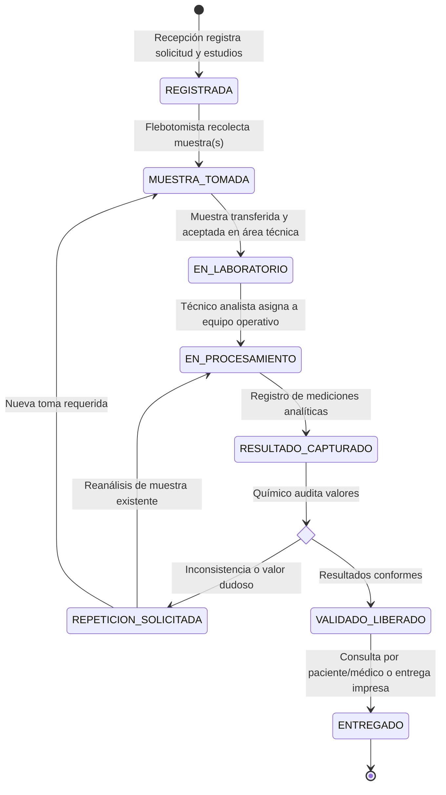

# Especificación de Requerimientos Funcionales y Restricciones del Sistema
## Sistema de Gestión de un Laboratorio de Análisis Clínicos

---

### 1. Información General y Alcance del Documento

El presente documento establece formalmente el levantamiento y especificación de **Requerimientos Funcionales (RF)**, **Reglas de Negocio (RN)** y **Restricciones del Sistema (R)** para el desarrollo de la solución del Laboratorio de Análisis Clínicos.

Este documento se enfoca exclusivamente en la **lógica del negocio, flujos operativos, entradas/salidas y restricciones**, absteniéndose deliberadamente de definir tablas, modelos relacionales o esquemas de base de datos físicos en esta fase.

---

### 2. Flujo Operativo y Ciclo de Vida del Negocio

El sistema modela y gestiona el ciclo integral del laboratorio, desde la llegada del paciente hasta la entrega y consulta de sus resultados:

---

### 3. Requerimientos Funcionales (RF)

#### 3.1 Módulo de Pacientes y Antecedentes Clínicos
* **RF-01: Registro y Gestión de Expediente de Pacientes**
  - **Descripción**: El sistema debe permitir registrar y mantener actualizados los datos de identificación, demográficos y de contacto de los pacientes.
  - **Entradas**: Nombre completo, fecha de nacimiento, sexo biológico, documento de identificación único, domicilio, teléfono, correo electrónico y contacto de emergencia.
  - **Proceso**: Validación de unicidad de identificación, cálculo automático de edad cronológica al momento de la atención.
  - **Salidas**: Expediente único del paciente generado y disponible.
* **RF-02: Registro de Antecedentes Clínicos Relevantes**
  - **Descripción**: Permitir capturar antecedentes que influyen en la toma, procesamiento o interpretación de los estudios.
  - **Entradas**: Enfermedades crónicas (diabetes, hipertensión, nefropatías), alergias a reactivos/fármacos, medicación actual, estado de embarazo/lactancia y condiciones de preparación previa (horas de ayuno, dietas específicas).
  - **Salidas**: Ficha de antecedentes clínicos vinculada a la atención del paciente.
* **RF-03: Consulta de Historial Integral del Paciente**
  - **Descripción**: El sistema debe permitir consultar cronológicamente todas las solicitudes, estudios, muestras procesadas y resultados históricos emitidos para un paciente desde su primer ingreso.
  - **Salidas**: Reporte histórico ordenado por fecha con comparativa de valores analíticos en el tiempo.

#### 3.2 Módulo de Médicos Solicitantes
* **RF-04: Directorio y Registro de Médicos**
  - **Descripción**: Gestionar el catálogo de médicos facultados que prescriben análisis a los pacientes atendidos.
  - **Entradas**: Cédula profesional / registro sanitario, nombre completo, especialidad médica, institución hospitalaria / consultorio, teléfono de contacto y correo electrónico.
  - **Salidas**: Registro activo de médico disponible para vinculación en órdenes de servicio.
* **RF-05: Consulta de Productividad y Solicitudes por Médico**
  - **Descripción**: Permitir filtrar y reportar el conjunto de solicitudes, estudios prescritos y pacientes atendidos bajo la indicación de un médico específico en periodos delimitados.

#### 3.3 Módulo de Catálogo de Estudios y Valores de Referencia
* **RF-06: Catálogo Maestro de Estudios de Laboratorio**
  - **Descripción**: Administrar el portafolio de análisis clínicos que oferta la institución (inicialmente $\approx 100$ tipos de estudios).
  - **Entradas**: Código de estudio, nombre descriptivo, área analítica (hematología, química clínica, inmunología, uroanálisis, parasitología), metodología analítica, tipo de muestra biológica requerida, volumen mínimo, contenedor requerido (aditivo/anticoagulante), tiempo estimado de entrega e instrucciones preanalíticas para el paciente.
* **RF-07: Configuración de Parámetros y Valores de Referencia**
  - **Descripción**: El sistema debe permitir definir uno o múltiples analitos/parámetros para cada estudio, con sus respectivos valores de referencia esperados.
  - **Detalle de configuración**:
    - Tipos de resultado: Cuantitativo (numérico) o Cualitativo (texto/listas fijas: reactivo, positivo, negativo).
    - Unidades de medida estandarizadas (ej. $mg/dL$, $g/dL$, $UI/L$, $cel/\mu L$).
    - Rangos normales condicionados: límite inferior y límite superior segmentables por:
      - Sexo (masculino, femenino, indistinto).
      - Rango de edad (días, meses o años: neonatos, pediátricos, adultos, geriátricos).
    - Valores críticos o de pánico: límites que disparan alerta inmediata por riesgo vital del paciente.
    - Notas y leyendas interpretativas de apoyo clínico.

#### 3.4 Módulo de Solicitudes y Órdenes de Trabajo
* **RF-08: Emisión y Registro de Solicitudes de Laboratorio**
  - **Descripción**: Generar una nueva orden de servicio vinculando al paciente atendido, el médico prescriptor y la lista de estudios requeridos en la visita.
  - **Entradas**: Identificador del paciente, médico solicitante (opcional si es estudio particular voluntario), fecha/hora de registro, lista de uno o más estudios clínicos seleccionados y observaciones clínicas.
  - **Regla Operativa**: Un paciente puede solicitar múltiples estudios en una misma orden, y un mismo estudio puede solicitarse a múltiples pacientes.
* **RF-09: Trazabilidad y Control de Estados de la Solicitud**
  - **Descripción**: El sistema debe actualizar de forma automática o manual controlada el estado global de la solicitud conforme avanzan sus componentes individuales:
    1. `REGISTRADA`: Orden creada, paciente en espera de toma de muestra.
    2. `MUESTRAS_TOMADAS`: Todas las muestras biológicas necesarias han sido recolectadas.
    3. `EN_PROCESAMIENTO`: Al menos un estudio está en ejecución analítica.
    4. `PARCIALMENTE_COMPLETADA`: Ciertos estudios cuentan con resultado validado y otros siguen en análisis.
    5. `CONCLUIDA`: La totalidad de estudios solicitados tienen resultados oficialmente validados.
    6. `ENTREGADA`: Resultados notificados y entregados al paciente o médico.
    7. `CANCELADA`: Solicitud anulada previo a la toma de muestra (con justificación obligatoria).

#### 3.5 Módulo de Recolección y Control de Muestras
* **RF-10: Generación de Requerimiento de Muestras por Solicitud**
  - **Descripción**: Al registrar una solicitud, el sistema debe deducir automáticamente la lista de muestras biológicas requeridas a partir de los estudios ordenados.
  - **Regla**: Si dos estudios requieren el mismo tipo de muestra biológica, contenedor y aditivo (ej. Glucosa y Perfil Lipídico en Suero con tubo tapón rojo), el sistema debe permitir compartir la misma muestra para evitar flebotomías duplicadas innecesarias al paciente, salvo que los protocolos analíticos exijan tomas independientes.
* **RF-11: Registro y Trazabilidad de Toma de Muestra**
  - **Descripción**: Registrar el acto físico de extracción biológica.
  - **Entradas**: Código identificador único de muestra (impresión de etiqueta con código de barras), fecha y hora exacta de recolección, personal flebotomista responsable, tipo de muestra, contenedor y observaciones preanalíticas (ej. paciente con 8 horas de ayuno).
  - **Estados de Muestra**: `PENDIENTE` $\rightarrow$ `TOMADA` $\rightarrow$ `RECIBIDA_EN_LAB` $\rightarrow$ `RECHAZADA_INADECUADA` $\rightarrow$ `EN_ANALISIS` $\rightarrow$ `PROCESADA` $\rightarrow$ `AGOTADA`.
* **RF-12: Rechazo e Incidencias de Muestras**
  - **Descripción**: Permitir marcar una muestra como inadecuada antes o durante el procesamiento (hemolizada, coagulada, lipémica, volumen insuficiente) solicitando de inmediato una nueva recolección.
* **RF-13: Monitor de Muestras Pendientes de Análisis**
  - **Descripción**: Listar en tiempo real todas las muestras que ya fueron tomadas al paciente pero que aún no han ingresado a fase analítica en los equipos.

#### 3.6 Módulo de Equipos Analíticos y Procesamiento
* **RF-14: Catálogo y Estado Operativo de Equipos**
  - **Descripción**: Gestionar los analizadores clínicos del laboratorio (inicialmente 15 equipos).
  - **Entradas**: Nombre del equipo, modelo, marca, número de serie, fecha de adquisición, registro de calibraciones y mantenimientos preventivos.
  - **Estado Operativo**: `ACTIVO / OPERATIVO`, `FUERA_DE_SERVICIO` (avería o falla técnica), `EN_MANTENIMIENTO`, `EN_CALIBRACION`.
* **RF-15: Homologación y Compatibilidad Estudio-Equipo**
  - **Descripción**: Registrar qué equipos son técnica y analíticamente aptos para procesar determinados estudios. Un equipo puede procesar diversos tipos de estudios, y un estudio puede procesarse en diferentes equipos compatibles.
* **RF-16: Bloqueo y Redireccionamiento por Equipos Fuera de Servicio**
  - **Descripción**: Si un equipo se marca como `FUERA_DE_SERVICIO`, el sistema debe impedir de inmediato que se inicien nuevos procesamientos en él y emitir una alerta para reasignar las muestras a equipos alternativos compatibles.
* **RF-17: Registro de Procesamiento Analítico**
  - **Descripción**: Bitácora de la corrida analítica.
  - **Datos requeridos**: Estudio analizado, muestra utilizada, equipo analítico empleado, técnico laboratorista responsable, lote de reactivos, fecha/hora de inicio y fecha/hora de finalización.
* **RF-18: Monitor de Estudios Pendientes con Muestra Tomada**
  - **Descripción**: Consulta especializada que identifique con precisión aquellos estudios cuya muestra biológica ya fue extraída y aceptada en laboratorio, pero cuyo procesamiento analítico no ha comenzado o se encuentra pendiente de resultados.

#### 3.7 Módulo de Resultados, Validación y Auditoría
* **RF-19: Captura de Mediciones y Resultados**
  - **Descripción**: Registro de los valores obtenidos en los análisis para cada analito de la prueba.
  - **Entradas**: Valor medido (cuantitativo o cualitativo), observaciones técnicas del analista, fecha/hora de captura y técnico que captura.
  - **Comportamiento automático**: El sistema debe contrastar el valor capturado contra el rango de referencia (filtrado por sexo y edad del paciente) e indicar visualmente si está dentro de la norma, alto, bajo o en rango de pánico/crítico.
* **RF-20: Flujo de Validación y Liberación Médica**
  - **Descripción**: El Químico Responsable revisa los resultados capturados. Los resultados se mantienen en estado `PRELIMINAR / PENDIENTE_VALIDACION` hasta que el químico autoriza su liberación formal, pasando a estado `VALIDADO / LIBERADO`.
* **RF-21: Gestión de Repeticiones por Inconsistencias Analíticas**
  - **Descripción**: Cuando un resultado obtenido presenta discrepancias clínicas, interferencias analíticas o valores incompatibles con la fisiología del paciente, el sistema debe permitir solicitar y registrar una repetición de la prueba.
  - **Mecanismo**:
    - Se registra el motivo obligatorio del reanálisis (ej. "valor fuera de delta check histórico", "sospecha de dilución", "equipo descalibrado").
    - Se define si se reanaliza una alícuota de la muestra existente o si se requiere una nueva toma de muestra.
    - Se genera una nueva corrida analítica asociada al estudio sin sobreescribir destructivamente el dato original.
* **RF-22: Versionado y Bitácora de Modificaciones de Resultados**
  - **Descripción**: Conservar la historia inmutable de todas las modificaciones, correcciones o repeticiones de resultados.
  - **Información registrada**: Identificador del resultado, número de versión secuencial, valor anterior, valor nuevo, usuario responsable de la modificación, fecha y hora exacta, motivo de cambio y bandera de resultado oficial vigente.

#### 3.8 Módulo de Consultas y Reportería
* **RF-23: Consulta de Resultados Asociados a una Solicitud**
  - **Descripción**: Despliegue consolidado de todos los estudios y parámetros incluidos en una orden de servicio, indicando estado de cada uno, valores obtenidos, unidades y rangos de normalidad.
* **RF-24: Reporte de Productividad y Uso por Equipo**
  - **Descripción**: Generar estadísticas de la cantidad de análisis procesados por cada equipo analítico en un rango de fechas determinado, con desglose de pruebas exitosas y pruebas repetidas.
* **RF-25: Reporte de Actividad por Periodo Determinado**
  - **Descripción**: Métricas operativas globales entre dos fechas: número total de pacientes atendidos, solicitudes procesadas, estudios ejecutados por área analítica y porcentaje de repeticiones.

---

### 4. Restricciones del Sistema

#### 4.1 Restricciones de Negocio y Reglas Operativas (RN)
* **RN-01 (Precondición de Procesamiento)**: Ningún estudio puede ingresar a estado de procesamiento si las muestras biológicas requeridas no se encuentran en estado `TOMADA` o `RECIBIDA_EN_LAB`.
* **RN-02 (Aptitud Analítica de Equipos)**: El sistema debe rechazar la asignación de un estudio a un equipo que no esté registrado como compatible con dicha prueba.
* **RN-03 (Bloqueo Estricto de Equipos Inoperativos)**: Un equipo con estatus `FUERA_DE_SERVICIO`, `EN_MANTENIMIENTO` o `EN_CALIBRACION` queda inhabilitado de forma estricta para recibir nuevas asignaciones analíticas.
* **RN-04 (Relación Estudio - Muestra)**: Un estudio clínico puede requerir una o múltiples muestras biológicas distintas (ej. perfil que requiere suero y orina de 24 horas; pruebas seriadas con tomas en tiempos específicos).
* **RN-05 (Inmutabilidad y No Sobreescritura)**: Queda estrictamente prohibida la sobreescritura destructiva o eliminación de resultados previos. Toda alteración o reanálisis debe dar origen a una nueva versión auditada.
* **RN-06 (Conservación Histórica Permanente)**: La información de pacientes, médicos, solicitudes y resultados debe mantenerse disponible indefinidamente en el historial, independientemente de si el paciente o el médico vuelven a utilizar los servicios del laboratorio. Queda prohibido el borrado físico (`DELETE` en cascada).
* **RN-07 (Trazabilidad de Repeticiones)**: Toda repetición de estudio debe contener obligatoriamente el motivo del reanálisis y la autorización de un usuario con rol de supervisión/químico responsable.
* **RN-08 (Entrega Exclusiva de Resultados Validados)**: Los pacientes, médicos solicitantes y personal de recepción únicamente pueden visualizar, consultar o imprimir resultados que hayan alcanzado el estado de `VALIDADO / LIBERADO`.

#### 4.2 Restricciones de Datos e Integridad Lógica (RI)
* **RI-01 (Integridad Temporal y Secuencial)**:
  - La fecha/hora de toma de muestra debe ser posterior o igual a la fecha/hora de creación de la solicitud.
  - La fecha/hora de inicio de procesamiento debe ser posterior o igual a la toma de muestra.
  - La fecha/hora de emisión del resultado debe ser posterior o igual a la fecha de procesamiento.
  - La fecha/hora de validación debe ser posterior o igual a la captura del resultado.
* **RI-02 (Validación de Parámetros de Referencia)**:
  - En analitos cuantitativos numéricos, el límite inferior de referencia debe ser estrictamente menor o igual al límite superior de referencia.
  - No se permiten valores negativos en concentraciones o mediciones biológicas salvo pruebas que admitan escalas con valores relativos negativos definidos por catálogo.
* **RI-03 (Unicidad Operativa)**:
  - Cada solicitud debe contar con un folio único e irrepetible.
  - Cada contenedor/muestra debe portar un identificador unívoco de código de barras a nivel sistema.
  - El expediente del paciente debe contar con una clave única de identificación ciudadana o registro interno para evitar duplicidad de expedientes.

#### 4.3 Restricciones Técnicas, de Rendimiento y Escalabilidad (RT)
* **RT-01 (Volumetría y Capacidad Inicial)**:
  - Capacidad inicial de arranque: $\approx 5,000$ pacientes registrados, $50$ médicos prescriptores, $100$ tipos de estudios, $10$ técnicos laboratoristas y $15$ equipos analizadores.
* **RT-02 (Tasa de Transaccionalidad Diaria)**:
  - Atención promedio diaria: $\approx 150$ pacientes.
  - Cada paciente solicita varios estudios durante su visita (promedio estimado: 2 a 4 estudios por solicitud).
  - Tasa de generación estimada: $\approx 300 \text{ a } 600$ estudios por día y entre $600 \text{ a } 2,000$ mediciones de parámetros analíticos diarios.
* **RT-03 (Escalabilidad y Crecimiento ante Alto Volumen)**:
  - Ante la situación adicional de incremento considerable de volumen de muestras procesadas, el sistema debe garantizar:
    - Almacenamiento y procesamiento eficiente de más de $1,000,000$ de resultados al año.
    - Tiempos de respuesta para consultas de historial de pacientes menores a 2 segundos, independientemente del volumen acumulado de años previos.
    - Capacidad de indexación optimizada y particionamiento temporal de las estructuras transaccionales de alto crecimiento (resultados, mediciones y auditorías).
* **RT-04 (Disponibilidad y Concurrencia)**:
  - El sistema debe soportar el acceso concurrente del personal de recepción, flebotomía y analistas en laboratorio sin bloqueos transaccionales prolongados (evitar *deadlocks* en la asignación de muestras y equipos).

#### 4.4 Restricciones de Seguridad, Privacidad y Confidencialidad (RS)
* **RS-01 (Confidencialidad de Información Médica Sensible)**:
  - Los datos demográficos y clínicos del paciente constituyen información altamente sensible y deben estar protegidos contra accesos no autorizados.
* **RS-02 (Aislamiento de Información por Usuario Externo)**:
  - Un paciente solo puede acceder a su propio expediente e historial.
  - Un médico solo puede acceder a los resultados de las solicitudes emitidas bajo su nombre o adscripción médica.
* **RS-03 (Segregación de Funciones - SoD)**:
  - Ningún usuario puede validar técnicamente un resultado si no cuenta con el perfil de Químico Responsable.
  - El personal de recepción y flebotomía no tiene permisos para capturar o alterar mediciones analíticas.

---

### 5. Criterios de Aceptación Operativa del Sistema

1. **Gestión de Paciente y Solicitud**: El sistema registra una orden de servicio con múltiples estudios para un paciente en menos de 1 minuto, emitiendo las órdenes de toma requeridas.
2. **Control de Muestras y Pendientes**: El sistema permite filtrar en 1 clic todos los estudios que tienen su muestra ya recolectada y aceptada en laboratorio pero cuyo procesamiento aún no ha comenzado.
3. **Respuesta ante Falla de Equipo**: Al cambiar el estado de un equipo a `FUERA_DE_SERVICIO`, ninguna muestra puede ser asignada a dicho equipo, y el sistema muestra la lista de analizadores compatibles alternativos disponibles.
4. **Ciclo de Repetición Auditada**: Toda prueba repetida conserva el resultado original, marca la causa de inconsistencia, registra el nuevo resultado y permite al Químico Responsable dictaminar cuál es el valor oficial liberado, manteniendo la bitácora inalterable.
5. **Historial Clínico Permanente**: Toda consulta histórica de un paciente retorna la totalidad de análisis realizados, incluso si la fecha de la última atención data de varios años atrás o si el paciente fue dado de baja operativa.