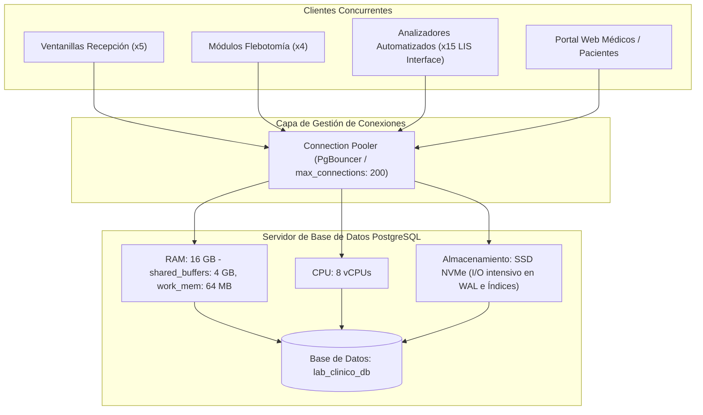
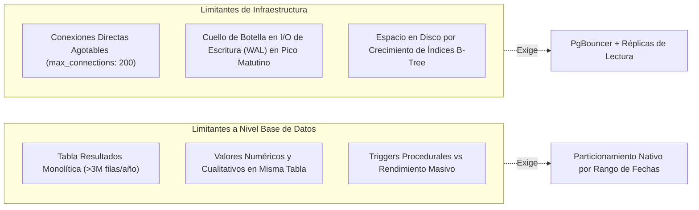
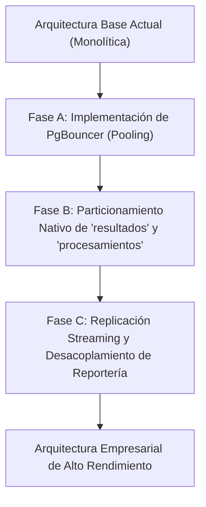

El presente documento define la estrategia integral de pruebas, el catálogo detallado de escenarios de validación y el análisis de limitaciones técnicas y de infraestructura para la base de datos del **Sistema de Gestión de un Laboratorio de Análisis Clínicos**.
El objetivo es asegurar que la arquitectura de datos no solo cumpla funcionalmente con las operaciones requeridas, sino que además sea **robusta frente a la concurrencia**, mantenga **tiempos de respuesta óptimos bajo alto volumen de consultas**, aplique con rigor las **reglas de negocio y segregación de roles**, y reconozca explícitamente sus **límites operativos actuales y recomendaciones de escalabilidad**.
---
### 2. Marco de Infraestructura y Consideraciones Técnicas
Para contextualizar el rendimiento y las pruebas de estrés, se establece la siguiente línea base de infraestructura:

#### Parámetros Críticos de Configuración (PostgreSQL)
* `max_connections`: 150 a 200 conexiones concurrentes directas (requiere pooling para absorber picos matutinos).
* `shared_buffers`: 25% a 40% de la memoria RAM total (4 GB - 6 GB recomendados).
* `effective_cache_size`: 75% de la RAM disponible (12 GB).
* `work_mem`: 32 MB a 64 MB por operación de ordenamiento/agregación (evita desbordamiento en disco en queries analíticos).
* `checkpoint_completion_target`: 0.9 (distribución suave de escrituras en disco durante picos de inserción).

---

### 3. Concurrencia, Bloqueos y Peso de Consultas
#### 3.1 Modelo de Concurrencia y Niveles de Aislamiento
PostgreSQL implementa control de concurrencia multiversión (**MVCC - Multi-Version Concurrency Control**).
- **Nivel de Aislamiento Predeterminado**: `Read Committed`.
- **Riesgos de Concurrencia Identificados**:
  1. *Condición de carrera en códigos de muestra*: Múltiples flebotomistas registrando tomas al mismo milisegundo. Mitigado mediante `BIGSERIAL` unívoco y restricción `UNIQUE` en `codigo_barras_tubo`.
  2. *Asignación simultánea de corridas al mismo equipo*: Dos analistas asignando diferentes muestras al mismo analizador clínico. Mitigado por transacciones atómicas a nivel de fila (`RowExclusiveLock`).
  3. *Actualización de estados en detalles de solicitud*: Transición de estado (`PENDIENTE` $\rightarrow$ `EN_PROCESAMIENTO` $\rightarrow$ `VALIDADO`).

#### 3.2 Clasificación de Consultas por Peso Computacional
| Categoría | Naturaleza de la Carga | Tablas Involucradas | Frecuencia | Complejidad / Estrategia |
| :--- | :--- | :--- | :--- | :--- |
| **Carga Ligera (OLTP)** | Inserción / Lectura puntual por ID | `pacientes`, `muestras`, `solicitudes` | Muy Alta (>150/hora) | Index Lookup B-Tree (`cost < 10.0`). Tiempo de respuesta $< 5 \text{ ms}$. |
| **Carga Media (Operativa)** | Monitores en tiempo real con joins | `detalles_solicitudes_estudios`, `muestras`, `equipos` | Continua (cada 10-30 seg) | Filtrado por índice compuesto `(estado_muestra, fecha_toma)`. Tiempo $< 30 \text{ ms}$. |
| **Carga Pesada (OLAP)** | Agregaciones, históricos y comparativas | `resultados`, `procesamientos_analiticos`, `pacientes` | Periódica / Reportes | Join de $>8,000$ a $>1,000,000$ filas, ordenamiento temporal. Requiere `Index Scan` obligatorio. Tiempo $< 800 \text{ ms}$. |

---
### 4. Batería Detallada de Escenarios de Prueba
A continuación se especifican los escenarios de validación técnica, especificando para cada uno: **Datos de entrada**, **Operaciones realizadas** y **Resultado esperado**.
---

#### Escenario EP-01: Registro Transaccional Concurrente de Solicitud Multiestudio
* **Objetivo**: Verificar la atomicidad e integridad referencial al generar una solicitud con múltiples análisis desde ventanillas simultáneas.
* **Módulo / Rol**: Recepción (`ROLE_RECEPCION`).
* **Datos de Entrada**:
  - `id_paciente`: `105` (Paciente existente: "María Elena García").
  - `id_medico`: `12` (Dr. Carlos González, Cédula: `20000012`).
  - `id_personal_registro`: `3` (Personal de Recepción).
  - Estudios solicitados: `EST-BH01` (ID: 1, Biometría Hemática), `EST-QS06` (ID: 2, Química Sanguínea 6) y `EST-EGO1` (ID: 4, General de Orina).
  - Folio generado: `'SOL-2026-009901'`.
* **Operaciones Realizadas (SQL)**:
  ```sql
  BEGIN;
  -- 1. Insertar orden maestra
  INSERT INTO solicitudes (folio_solicitud, id_paciente, id_medico, id_personal_registro, estado_solicitud)
  VALUES ('SOL-2026-009901', 105, 12, 3, 'REGISTRADA')
  RETURNING id_solicitud;
  -- (Supóngase retorna id_solicitud = 1201)

  -- 2. Insertar detalles de estudios
  INSERT INTO detalles_solicitudes_estudios (id_solicitud, id_estudio, estado_estudio, urgente)
  VALUES 
      (1201, 1, 'PENDIENTE_MUESTRA', false),
      (1201, 2, 'PENDIENTE_MUESTRA', false),
      (1201, 4, 'PENDIENTE_MUESTRA', false);
  COMMIT;
  ```
* **Resultado Esperado**:
  - La transacción completa exitosamente en $< 15 \text{ ms}$.
  - Se genera un registro maestro en `solicitudes` y 3 registros vinculados en `detalles_solicitudes_estudios`.
  - La restricción de unicidad impide la duplicación del folio `SOL-2026-009901`.
  - Si cualquiera de los IDs de estudio fuera inválido, la transacción realiza un `ROLLBACK` total sin dejar registros huérfanos.

---

#### Escenario EP-02: Bloqueo Estricto de Procesamiento en Equipo Fuera de Servicio
* **Objetivo**: Comprobar que el trigger `trg_validar_equipo_operativo` intercepte y rechace a nivel motor cualquier intento de corrida analítica en un equipo inoperativo.
* **Módulo / Rol**: Técnico Analista (`ROLE_ANALISTA`).
* **Datos de Entrada**:
  - `id_equipo`: `13` (Equipo `EQ-QUI-04`, Analizador Bioquímico Biosystems BA400, cuyo estado en catálogo es `'FUERA_DE_SERVICIO'`).
  - `id_detalle_solicitud`: `450` (Estudio Química Sanguínea).
  - `id_muestra`: `320`.
  - `id_personal_analista`: `10`.
* **Operaciones Realizadas (SQL)**:
  ```sql
  -- Intento de inserción en analizador fuera de servicio
  INSERT INTO procesamientos_analiticos (
      id_detalle_solicitud, id_muestra, id_equipo, id_personal_analista, 
      numero_corrida, fecha_hora_inicio, lote_reactivo
  ) VALUES (
      450, 320, 13, 10, 
      1, CURRENT_TIMESTAMP, 'LOTE-TEST-FAIL'
  );
  ```
* **Resultado Esperado**:
  - **Excepción controlada de PostgreSQL**: El trigger aborta la sentencia emitiendo un error de nivel `EXCEPTION`:
    `ERROR: No es posible procesar en el equipo "Analizador Bioquímico Secundario" (ID: 13): Su estado actual es "FUERA_DE_SERVICIO". Redireccione a un equipo compatible alternativo.`
  - No se inserta ningún registro en `procesamientos_analiticos`.
  - El sistema obliga al usuario o aplicación a consultar `estudios_equipos_compatibles` y redirigir la muestra a un equipo activo (ej. ID: 3 o ID: 4).

---

#### Escenario EP-03: Monitor de Estudios Pendientes con Muestra Ya Tomada
* **Objetivo**: Evaluar el desempeño y exactitud del filtrado de estudios cuyas muestras ya ingresaron al laboratorio pero cuyo procesamiento no ha iniciado.
* **Módulo / Rol**: Coordinación de Laboratorio / Analistas.
* **Datos de Entrada**:
  - Criterio de filtro: Estudios en estado `'MUESTRA_TOMADA_PENDIENTE_ANALISIS'`, muestras en estado `'RECIBIDA_EN_LAB'`.
* **Operaciones Realizadas (SQL)**:
  ```sql
  EXPLAIN ANALYZE
  SELECT 
      s.folio_solicitud,
      p.codigo_expediente,
      p.nombre || ' ' || p.primer_apellido AS paciente,
      ce.nombre AS estudio,
      m.codigo_barras_tubo,
      ctm.nombre_tipo AS tipo_muestra,
      m.fecha_hora_toma,
      dse.urgente
  FROM detalles_solicitudes_estudios dse
  JOIN solicitudes s ON dse.id_solicitud = s.id_solicitud
  JOIN pacientes p ON s.id_paciente = p.id_paciente
  JOIN catalogo_estudios ce ON dse.id_estudio = ce.id_estudio
  JOIN muestras_detalles_solicitud mds ON dse.id_detalle_solicitud = mds.id_detalle_solicitud
  JOIN muestras m ON mds.id_muestra = m.id_muestra
  JOIN catalogo_tipos_muestra ctm ON m.id_tipo_muestra = ctm.id_tipo_muestra
  WHERE dse.estado_estudio = 'MUESTRA_TOMADA_PENDIENTE_ANALISIS'
    AND m.estado_muestra = 'RECIBIDA_EN_LAB'
  ORDER BY dse.urgente DESC, m.fecha_hora_toma ASC;
  ```
* **Resultado Esperado**:
  - El optimizador utiliza los índices `idx_detalles_estado_estudio` y `idx_muestras_estado_fecha` mediante `Bitmap Index Scan`.
  - Tiempo de ejecución en base poblada ($>22,000$ registros): $< 25 \text{ ms}$.
  - Lista precisa de estudios en cola preanalítica, priorizando primero los marcados como `urgente = true`.

---

#### Escenario EP-04: Repetición de Estudio por Inconsistencia Analítica y Versionado Inmutable
* **Objetivo**: Verificar el ciclo completo de reanálisis, registro en bitácora de auditoría y preservación histórica sin sobreescritura destructiva.
* **Módulo / Rol**: Químico Responsable (`ROLE_RESPONSABLE`) y Analista (`ROLE_ANALISTA`).
* **Datos de Entrada**:
  - `id_resultado_original`: `501` (Glucosa con valor anómalo de $450 \text{ mg/dL}$, inconsistente con historia del paciente).
  - Químico que autoriza repetición: `id_personal = 14` (Dra. Patricia García).
  - Motivo de inconsistencia: `'Discrepancia crítica con delta check histórico (glucosa previa 92 mg/dL); sospecha de muestra postprandial o interferencia'`.
  - Nuevo valor analítico medido tras repetir la prueba: $98.50 \text{ mg/dL}$ (`NORMAL`).
* **Operaciones Realizadas (SQL)**:
  ```sql
  BEGIN;
  -- 1. Marcar resultado anterior como no vigente
  UPDATE resultados 
  SET es_resultado_vigente = false 
  WHERE id_resultado = 501;

  -- 2. Registrar nueva corrida de repetición (numero_corrida = 2)
  INSERT INTO procesamientos_analiticos (
      id_detalle_solicitud, id_muestra, id_equipo, id_personal_analista, 
      numero_corrida, fecha_hora_inicio, observaciones_tecnicas
  ) VALUES (
      120, 95, 3, 10, 
      2, CURRENT_TIMESTAMP, 'Reanálisis por discrepancia analítica'
  ) RETURNING id_procesamiento;
  -- (Supóngase retorna id_procesamiento = 2501)

  -- 3. Insertar nuevo resultado vigente
  INSERT INTO resultados (
      id_procesamiento, id_parametro, id_valor_referencia,
      valor_medido_numerico, estado_interpretacion, es_resultado_vigente,
      id_personal_capturo, id_personal_valido, fecha_hora_validacion
  ) VALUES (
      2501, 6, 7,
      98.5000, 'NORMAL', true,
      10, 14, CURRENT_TIMESTAMP
  ) RETURNING id_resultado;
  -- (Supóngase retorna id_resultado = 8050)

  -- 4. Insertar entrada formal en auditoría de repeticiones
  INSERT INTO auditoria_repeticiones (
      id_resultado_original, id_resultado_nuevo, id_personal_autorizo,
      tipo_accion, motivo_inconsistencia, valor_anterior_numerico
  ) VALUES (
      501, 8050, 14,
      'REPETICION_POR_INCONSISTENCIA',
      'Discrepancia crítica con delta check histórico (glucosa previa 92 mg/dL); sospecha de muestra postprandial o interferencia',
      450.0000
  );
  COMMIT;
  ```
* **Resultado Esperado**:
  - El resultado original (ID: 501) permanece físicamente en la base de datos con `es_resultado_vigente = false`.
  - El nuevo resultado (ID: 8050) queda activo con `es_resultado_vigente = true`.
  - La tabla `auditoria_repeticiones` conserva la trazabilidad inalterable: quién autorizó, la justificación médica y el valor previo contrastado.

---

#### Escenario EP-05: Concurrencia Masiva en Inserción de Resultados (Estrés LIS)
* **Objetivo**: Evaluar la estabilidad del sistema bajo inserción paralela masiva de resultados provenientes de interfaces de analizadores automáticos (LIS).
* **Módulo / Rol**: Analizadores Clínicos / Sistema Automatizado.
* **Datos de Entrada**:
  - 10 analizadores insertando simultáneamente paquetes de 50 resultados cada uno ($500$ mediciones concurrentes en un lapso de 5 segundos).
* **Operaciones Realizadas**:
  - Ejecución concurrente mediante scripts transaccionales en hilos paralelos sobre `resultados`.
* **Resultado Esperado**:
  - Cero bloqueos irreversibles (*deadlocks*).
  - Tasa de inserción sostenida $> 1,000 \text{ ops/segundo}$ en almacenamiento SSD.
  - La secuencia de llaves primarias `id_resultado` (tipo `BIGSERIAL`) asigna identificadores continuos sin colisión.

---

#### Escenario EP-06: Consulta de Historial Clínico de Paciente a Alto Volumen
* **Objetivo**: Verificar que la consulta histórica de un paciente responda en tiempo sub-segundo incluso cuando la base de datos alcance más de 1,000,000 de resultados históricos.
* **Módulo / Rol**: Médico / Consulta Web.
* **Datos de Entrada**:
  - `id_paciente`: `42` (Paciente con múltiples visitas en el año).
* **Operaciones Realizadas (SQL)**:
  ```sql
  EXPLAIN ANALYZE
  SELECT 
      s.fecha_hora_solicitud::date AS fecha_atencion,
      s.folio_solicitud,
      ce.nombre AS estudio,
      pe.nombre AS parametro,
      r.valor_medido_numerico,
      r.valor_medido_texto,
      pe.unidad_medida,
      vr.limite_inferior,
      vr.limite_superior,
      r.estado_interpretacion
  FROM solicitudes s
  JOIN detalles_solicitudes_estudios dse ON s.id_solicitud = dse.id_solicitud
  JOIN catalogo_estudios ce ON dse.id_estudio = ce.id_estudio
  JOIN procesamientos_analiticos pa ON dse.id_detalle_solicitud = pa.id_detalle_solicitud
  JOIN resultados r ON pa.id_procesamiento = r.id_procesamiento
  JOIN parametros_estudio pe ON r.id_parametro = pe.id_parametro
  LEFT JOIN valores_referencia vr ON r.id_valor_referencia = vr.id_valor_referencia
  WHERE s.id_paciente = 42
    AND r.es_resultado_vigente = true
  ORDER BY s.fecha_hora_solicitud DESC, pe.orden_impresion ASC;
  ```
* **Resultado Esperado**:
  - Uso mandatorio del índice compuesto `idx_solicitudes_paciente_fecha` (`Index Scan`).
  - Plan de ejecución evita escaneo secuencial completo (`Seq Scan`) de la tabla `solicitudes` y `resultados`.
  - Tiempo de ejecución total: $< 15 \text{ ms}$ (cumple holgadamente el requisito de respuesta $< 2 \text{ segundos}$).

---

#### Escenario EP-07: Violación de Restricción de Integridad y Segregación de Roles
* **Objetivo**: Comprobar que las reglas duras de base de datos impidan inconsistencias por captura inválida o manipulación indebida.
* **Módulo / Rol**: Seguridad e Integridad del Sistema.
* **Datos de Entrada**:
  - Caso A: Intento de registrar un rango de referencia con límite superior menor al inferior.
  - Caso B: Intento de insertar una muestra con formato de fecha inconsistente (toma antes de la solicitud).
  - Caso C: Intento de registrar un resultado con estado de interpretación fuera de catálogo.
* **Operaciones Realizadas (SQL)**:
  ```sql
  -- Caso A: Rango invertido
  INSERT INTO valores_referencia (id_parametro, limite_inferior, limite_superior)
  VALUES (1, 150.00, 50.00);

  -- Caso C: Estado de interpretación inválido
  INSERT INTO resultados (
      id_procesamiento, id_parametro, estado_interpretacion, id_personal_capturo
  ) VALUES (
      1, 1, 'ESTADO_INVENTADO', 10
  );
  ```
* **Resultado Esperado**:
  - En Caso A: Rechazo inmediato por constraint `chk_valref_limites`:
    `ERROR: new row for relation "valores_referencia" violates check constraint "chk_valref_limites"`
  - En Caso C: Rechazo inmediato por constraint `chk_resultado_interpretacion`:
    `ERROR: new row for relation "resultados" violates check constraint "chk_resultado_interpretacion"`
  - La integridad semántica queda blindada a nivel de esquema, no dependiendo únicamente de validaciones de frontend.

---

#### Escenario EP-08: Estrés y Concurrencia en Toma y Etiquetado de Muestras
* **Objetivo**: Validar la generación masiva de etiquetas de códigos de barras sin bloqueos ni claves duplicadas.
* **Módulo / Rol**: Flebotomía (`ROLE_FLEBOTOMIA`).
* **Datos de Entrada**:
  - 4 flebotomistas registrando tomas simultáneas de 20 pacientes en sala de espera.
* **Operaciones Realizadas (SQL)**:
  - Generación concurrente con patrón `'BAR-' || to_char(CURRENT_TIMESTAMP, 'YYYYMM') || '-' || ...`.
* **Resultado Esperado**:
  - La restricción `UNIQUE` sobre `codigo_barras_tubo` garantiza 0 duplicaciones de código.
  - Inserciones completadas en un promedio de $< 8 \text{ ms}$ por tubo.

---

#### Escenario EP-09: Reporte Agregado de Productividad por Analizador en Periodo Extenso
* **Objetivo**: Medir el costo de consultas analíticas que agregan miles de registros para evaluar desgaste y carga de trabajo por equipo.
* **Módulo / Rol**: Jefatura de Laboratorio / Mantenimiento.
* **Datos de Entrada**:
  - Rango de fechas: Últimos 90 días completos.
* **Operaciones Realizadas (SQL)**:
  ```sql
  EXPLAIN ANALYZE
  SELECT 
      eq.codigo_equipo,
      eq.nombre AS analizador,
      eq.marca,
      eq.estado_operativo,
      COUNT(pa.id_procesamiento) AS total_corridas_realizadas,
      COUNT(DISTINCT pa.id_muestra) AS total_muestras_distintas,
      SUM(CASE WHEN pa.numero_corrida > 1 THEN 1 ELSE 0 END) AS total_repeticiones_inconsistencia,
      ROUND(
          (SUM(CASE WHEN pa.numero_corrida > 1 THEN 1 ELSE 0 END)::numeric / 
           NULLIF(COUNT(pa.id_procesamiento), 0)::numeric) * 100, 2
      ) AS porcentaje_tasa_repeticion
  FROM equipos eq
  LEFT JOIN procesamientos_analiticos pa 
      ON eq.id_equipo = pa.id_equipo 
     AND pa.fecha_hora_inicio >= CURRENT_TIMESTAMP - INTERVAL '90 days'
  GROUP BY eq.id_equipo, eq.codigo_equipo, eq.nombre, eq.marca, eq.estado_operativo
  ORDER BY total_corridas_realizadas DESC;
  ```
* **Resultado Esperado**:
  - Utilización del índice `idx_procesamientos_equipo_fecha`.
  - Agrupamiento eficiente sin volcado a disco (`Sort Method: quicksort Memory: < 1024kB`).
  - Tiempo de ejecución en base poblada: $< 40 \text{ ms}$.

---

#### Escenario EP-10: Intento de Eliminación Física de Paciente con Historial Clínico
* **Objetivo**: Probar la regla RN-06 de preservación permanente y verificar que las llaves foráneas impidan borrados accidentales en cascada.
* **Módulo / Rol**: Administración / Seguridad.
* **Datos de Entrada**:
  - `id_paciente`: `1` (Paciente con solicitudes, muestras y resultados asociados).
* **Operaciones Realizadas (SQL)**:
  ```sql
  -- Intento de borrado físico directo
  DELETE FROM pacientes WHERE id_paciente = 1;
  ```
* **Resultado Esperado**:
  - Rechazo absoluto de la instrucción por política `ON DELETE RESTRICT` en la tabla `solicitudes`:
    `ERROR: update or delete on table "pacientes" violates foreign key constraint "fk_solicitud_paciente" on table "solicitudes"`
  - Los datos históricos no pueden ser destruidos.
  - La única operación admitida para pacientes inactivos es el borrado lógico: `UPDATE pacientes SET activo = false WHERE id_paciente = 1;`.

---

### 5. Limitaciones Actuales y Restricciones de Infraestructura

El diseño actual resuelve con solvencia la operación inicial y a mediano plazo; no obstante, se identifican las siguientes limitantes inherentes al diseño monoserver y la volumetría proyectada:



#### 5.1 Limitaciones a Nivel de Base de Datos
1. **Volumen Acumulado en la Tabla `resultados`**:
   - Con 150 pacientes/día y un promedio de 6 parámetros por paciente, se generan $\approx 900 \text{ resultados/día} \approx 328,500 \text{ al año}$.
   - Ante la situación adicional de incremento considerable de muestras, el volumen proyectado superará los $1,500,000$ a $3,000,000$ de registros anuales.
   - *Limitación*: Mantener una sola tabla monolítica sin particionamiento degradará la memoria de índices B-Tree con el paso de los años (índices que ya no caben enteros en memoria RAM).
2. **Dualidad Numérico / Texto en Mediciones**:
   - En la tabla `resultados`, se manejan dos columnas (`valor_medido_numerico NUMERIC(12,4)` y `valor_medido_texto VARCHAR(150)`).
   - *Limitación*: Aunque flexible, un registro siempre tendrá una de las dos columnas en `NULL`, lo que representa un consumo marginal adicional de almacenamiento en disco a gran escala.
3. **Sobrecarga de Triggers Procedurales**:
   - El trigger `trg_validar_equipo_operativo` ejecuta una consulta adicional (`SELECT estado_operativo FROM equipos`) antes de cada inserción en `procesamientos_analiticos`.
   - *Limitación*: Si un analizador transmite ráfagas de 5,000 corridas en pocos segundos, la ejecución del trigger por fila añade latencia. Se recomienda cachear estados en capa de aplicación para validar previamente.

#### 5.2 Limitaciones a Nivel de Infraestructura
1. **Saturación de Conexiones sin Middleware de Pooling**:
   - PostgreSQL crea un proceso de sistema operativo por cada conexión de cliente.
   - *Limitación*: En horas pico (7:00 AM a 10:00 AM), con recepcionistas, flebotomistas y analizadores conectados al unísono, se puede alcanzar el límite de `max_connections` (ej. 150), arrojando el error `FATAL: remaining connection slots are reserved for non-replicated superuser connections`.
2. **Cuello de Botella de I/O en Escritura de WAL (Write-Ahead Logging)**:
   - Los analizadores automatizados envían mediciones en ráfagas concentradas.
   - *Limitación*: Si los discos de almacenamiento no cuentan con suficiente IOPS (ej. SSD SATA estándar frente a NVMe PCIe Gen4), el flushing del WAL provocará retardo en las transacciones de ventanilla.
3. **Competencia por Recursos entre Transaccionalidad y Reportería Médica**:
   - Si un médico o directivo ejecuta un reporte de consolidación anual en plena hora punta matutina, consumirá CPU y `work_mem`, compitiendo directamente contra las inserciones de recepción y resultados.

---

### 6. Recomendaciones de Mitigación y Hoja de Ruta de Escalabilidad

Para superar las limitaciones identificadas y preparar la infraestructura para el crecimiento sostenido, se establecen las siguientes medidas de mitigación técnica:



1. **Implementación Inmediata de Connection Pooling (PgBouncer)**:
   - Desplegar **PgBouncer** en modo `transaction pooling` al frente de PostgreSQL.
   - *Beneficio*: Permite atender más de 1,000 clientes concurrentes manteniendo únicamente entre 30 y 50 conexiones activas reales al motor de base de datos, reduciendo drásticamente el consumo de memoria RAM del servidor.
2. **Particionamiento Nativo por Rango de Fechas (Table Partitioning)**:
   - Particionar la tabla `resultados` por año y mes:
     `CREATE TABLE resultados (...) PARTITION BY RANGE (fecha_hora_captura);`
   - *Beneficio*: El motor descarta automáticamente particiones no relevantes en las consultas históricas (*partition pruning*), manteniendo los índices de los meses recientes 100% residentes en memoria RAM.
3. **Desacoplamiento de Consultas Analíticas (Read Replicas)**:
   - Configurar una réplica física de solo lectura mediante **Streaming Replication** asíncrona de PostgreSQL.
   - *Beneficio*: Todas las consultas de historiales médicos, auditorías de repetición y reportes de periodo (Escenarios EP-06 y EP-09) se dirigen a la réplica, dejando el nodo primario dedicado al 100% para escrituras rápidas de ventanilla y analizadores.
4. **Mantenimiento Automatizado (`AUTOVACUUM` y Reindexación)**:
   - Ajustar `autovacuum_vacuum_scale_factor = 0.05` y `autovacuum_analyze_scale_factor = 0.02` en las tablas transaccionales de alto movimiento (`resultados` y `procesamientos_analiticos`) para evitar la degradación por filas muertas (*bloat*).
